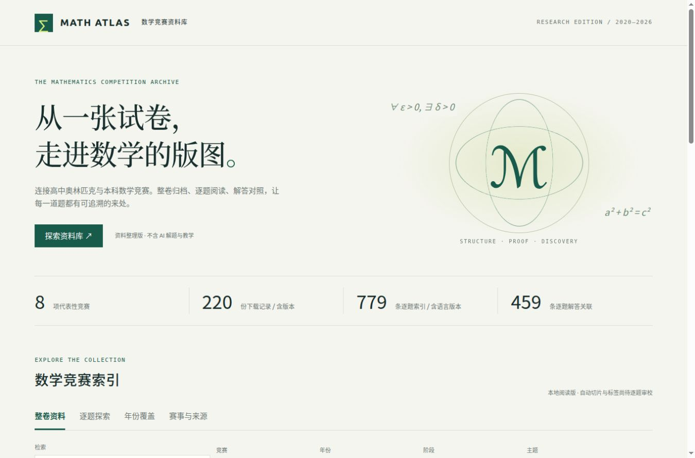

# Math Atlas · 数学竞赛资料库

2020–2026 年高中与本科数学竞赛的可追溯资料仓库。参考 Physics 的 `originals → derived → catalog → web` 结构，首版聚焦收集、整卷阅读、题解切分、分类与索引，**不生成 AI 解答、盲解或教学内容**。

首版快照（2026-11-16）：8 类赛事、226 条原始资源记录（221 条已下载）。阅读界面合并 EGMO 中英文重复记录，并重建一份 CMC 漏题索引后，共 769 条题目/大题组索引。已按原图读题、重排正文并标注内容主题的有 136 题，剩余 633 条仍待逐题整理，详见[正文整理进度](docs/EDITORIAL.md)。



## 阅读

```bash
python3 -m pip install -r requirements.txt
python3 scripts/build.py
python3 scripts/serve.py --background
# 打开 http://127.0.0.1:8092/
```

也可直接打开 `dist/library/index.html`，无需数据库。支持整卷、逐题、年份覆盖、赛事来源四个视图；赛事/年份/学段/主题/正文进度筛选，题目/答案/来源页签和题目深链接。已整理题目以中文正文呈现，下方可展开原图；数学公式与字体随站点打包，无需访问外部 CDN。

后台阅读服务由当前用户的 systemd 管理，不依赖对话或终端存活；仅监听 `127.0.0.1`，不设置登录自启。状态/停止：`python3 scripts/serve.py --status` / `python3 scripts/serve.py --stop`。不使用 systemd 时可运行 `python3 scripts/serve.py` 前台服务。构建后运行 `python3 scripts/check_delivery.py`，逐个核对网页实际返回的全部图片、原卷与前端文件。

## 范围

| 学段 | 中国 | 国际 / 国外 |
|---|---|---|
| 高中 | 全国高中数学联赛（一试、加试及 A/B/补赛版本）；CMO 全国决赛 | IMO；EGMO |
| 本科 | CMC 全国大学生数学竞赛（初赛/决赛与类别）；丘成桐大学生数学竞赛笔试 | IMC；Putnam |

**国内缺卷、图片卷切分及人工审校仍有待办**，详见[调研与缺口](docs/RESEARCH.md)、[覆盖表](docs/COVERAGE.md)、`catalog/review-queue.json`。记录数包含解答、语言版本和同文件的页范围索引；逐题记录也可能是大题组，不等于独立题目总数。

## 目录与更新

```text
catalog/       赛事、资源、题目、OCR 坐标、人工覆盖项与复核队列
originals/     下载原件、图片字节及来源清单（本地数据）
derived/       原页切片与复核后的题面/解答切片
web/           无框架静态阅读器
scripts/       采集、OCR、整理、索引、构建与验证
docs/          调研、数据约定与覆盖情况
dist/library/  完整离线阅读版（生成目录）
dist/public/   元数据与外链公开版（生成目录）
```

```bash
python3 scripts/collect.py
python3 scripts/collect_china_images.py
python3 scripts/curate.py
# 图片卷 OCR：需 tesseract-ocr-chi-sim 和 tesseract-ocr-eng 的 traineddata
# 可通过 TESSDATA_PREFIX 指定 tessdata 目录；无 OCR 时仍能阅读整卷
python3 scripts/ocr.py
python3 scripts/index.py
python3 scripts/build.py
python3 scripts/build.py --public
python3 scripts/validate.py
```

完整重新发现 Putnam 镜像需将 `https://github.com/rpxgit/The-Putnam-Archive` 克隆到 `tmp/putnam-source`；本次固定提交见调研文档。已有清单也可用 `python3 scripts/restore.py` 恢复可访问的原件。源站内容变更时，哈希不一致会拒绝覆盖。

边界修正使用 `catalog/anchor-overrides.json`，标签等字段修正使用 `catalog/overrides.json`，数据约定见 [DATA.md](docs/DATA.md)。OCR 结果不作为数学正文转录。

## 发布边界

原创代码 MIT；试题和解答归原作者，不随代码许可。原件、OCR、切片及完整构建默认不进入 Git；元数据保留来源和校验值。公开构建仅包含白名单元数据与外部链接，可用于 GitHub Pages，详见 [RIGHTS.md](RIGHTS.md)。未配置自动部署，也未推送远端。

截至 2026-11-16，本版为资料整理工作底稿；136 题已模型读图整理，其他题目仍保留原卷索引，不使用旧关键词猜测标签。
